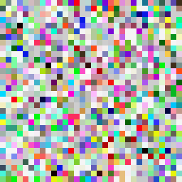
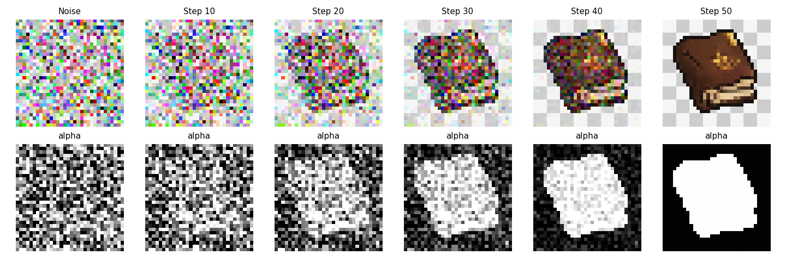

# Pixel Art Toy Model (`toy-pixelart-ddpm`)

An educational, from-scratch text-to-image diffusion model (DDPM/DDIM) that generates native **32×32 RGBA** pixel-art sprites with transparency.

The image U-Net (**24.5M parameters**) is built and trained from random weights directly in pixel space using plain PyTorch—no Stable Diffusion checkpoint, VAE, LoRA, or `diffusers` pipeline. The only pretrained component is a **frozen CLIP ViT-L/14 text encoder**.

Read my accompanying note: [Understanding Diffusion Model for Pixel Art Image Generator](https://tobypurbojo.com/notes/Understanding%20Diffusion%20Model%20for%20Pixel%20Art%20Image%20Generator%20416df4fe-71d8-80d3-b3b0-c37605676c19/).

---

## Sample Output

**Prompt:** `"pixel art icon of book"` · **Sampler:** `ddim` (`eta = 0.0`) · **Steps:** `50` · **CFG:** `4.0` · **Seed:** `123` · **Revision:** `25b88ec`

| Final Sprite (10× upscaled) | Denoising Animation |
| :---: | :---: |
|  |  |

**Denoising Snapshots:**

*(Full settings and native 32×32 PNG are in [`sprite-output/`](sprite-output/).)*

---

## Quickstart (Inference)

The fastest way to try the model is in Google Colab using the released weights on Hugging Face:

1. Open the inference notebook: **[Open in Colab](https://colab.research.google.com/drive/10gQ1exCUgDbCgFm3uCMVHjgpYdhDU8o3?usp=sharing)** (or use `PixelArt_Sprite_Inference_Colab.ipynb` in this repo).
2. Run all cells—the notebook installs dependencies and downloads the public EMA checkpoint from [`Tobyz11/toy-pixelart-ddpm`](https://huggingface.co/Tobyz11/toy-pixelart-ddpm).
3. Edit `PROMPT`, `SEED`, `SAMPLER` (`"ddim"` or `"ddpm"`), `STEPS` (default `50`), and `GUIDANCE` (default `4.0`) to generate sprites and inspect the denoising trajectory (composite RGBA, RGB-only, and alpha mask).

> Works on both GPU and CPU (GPU is recommended; 50 DDIM steps with CFG = 4.0 performs 100 U-Net evaluations).

---

## Repository Contents

| File | Description |
| --- | --- |
| `PixelArt_Sprite_Inference_Colab.ipynb` | Standalone inference & denoising-trajectory viewer using the published Hugging Face weights |
| `pixelart_text_ddpm.ipynb` | Standalone PyTorch training notebook (data prep, U-Net, DDPM/DDIM, EMA, validation, and resumable checkpointing) |
| `sprite-output/` | Example generated sprite (`sprite.png`, `sprite_10x.png`), denoising GIF/snapshots, `viewer.html`, and `settings.json` |
| `.gitignore` | Excludes local caches, datasets, credentials, and weight binaries |

---

## Model & Training Summary

### Architecture
- **Image U-Net (`TextUNet`):** 24,514,308 trainable parameters, 4-channel RGBA input/output (`[B, 4, 32, 32]`).
- **Resolution stages:** `32×32` (64 ch) → `16×16` (128 ch) → `8×8` (192 ch) → `4×4` (256 ch) bottleneck, with 2 residual blocks per encoder level and 3 per decoder level + skip connections.
- **Timestep conditioning:** 64-dim sinusoidal embedding → 256-dim MLP → per-block adaptive scale and shift (`GroupNorm` + FiLM).
- **Text conditioning:** Frozen `openai/clip-vit-large-patch14` text encoder (`123.1M` frozen params, max 48 tokens, 768-dim) → learned linear projection (`768 → 256`) → multi-head Cross-Attention (`head_dim = 64`) at `8×8` and `4×4` with padding mask.

### Diffusion & Training Setup (Recorded Run)
- **Dataset split:** 50,000 deduplicated training sprites + 512 validation sprites from [`azyg0s/pixelart-172k`](https://huggingface.co/datasets/azyg0s/pixelart-172k) (filtering `weak_grid` and `anisotropic_grid` flags; transparent RGB canonicalized to white; scaled to `[-1, 1]`).
- **Diffusion schedule:** 1,000 timesteps, cosine schedule (`cosine_s = 0.008`), $\epsilon$-prediction MSE loss.
- **Optimization:** 50 epochs (**39,100 updates**), logical batch size 64, AdamW (`lr = 1e-4`, `weight_decay = 0.01`, `grad_clip = 1.0`), 10% caption dropout for Classifier-Free Guidance, EMA decay `0.9999` (with warmup).
- **Hardware:** Google Colab NVIDIA L4 GPU (`bfloat16`), peak VRAM `2.20 GiB`.
- **Recorded loss metrics (Step 39,100):** Final training noise MSE `0.02640` | Best validation EMA noise MSE `0.02018`.

---

## Limitations

This is an educational **toy model**, not a production sprite generator:
- **MSE does not enforce pixel-art rules:** There is no explicit objective for clean 1-pixel outlines, limited color palettes, or crisp geometry.
- **Alpha channel artifacts:** Alpha is diffused identically to RGB (1/4 of the MSE loss) with no binary segmentation objective, which can lead to semi-transparent edges.
- **Low noise MSE $\neq$ strong visual quality:** Average noise-prediction MSE is not a direct measure of prompt adherence or sharpness.
- **Synthetic dataset noise:** Training captions come from synthetic generation prompts rather than human-verified labels, and only 50k of the 172k sprites were used in the recorded run.

---

## Credits, Dataset & Licensing

- **Training Dataset:** [`azyg0s/pixelart-172k`](https://huggingface.co/datasets/azyg0s/pixelart-172k) (revision `69157ce36974a3afcaf2465531cfab4c2a0e36bb`)
  - **Dataset License:** Published under the **MIT License** on Hugging Face.
  - **Synthetic Origin Note:** The dataset consists of AI-generated sprites created via a **Krea 2 Pixel-art LoRA** pipeline (~121k sprites) and sprite-sheet extraction (~51k sprites). If you plan to use generated outputs commercially, review both the dataset card and any applicable upstream synthetic-data terms.
- **Pretrained Text Encoder:** [`openai/clip-vit-large-patch14`](https://huggingface.co/openai/clip-vit-large-patch14) (revision `32bd64288804d66eefd0ccbe215aa642df71cc41`) — **MIT License**.
- **Code & Released Weights:** See [`Tobyz11/toy-pixelart-ddpm`](https://huggingface.co/Tobyz11/toy-pixelart-ddpm) for the published checkpoint and model card. *(Add a `LICENSE` file to this repository before public release.)*
